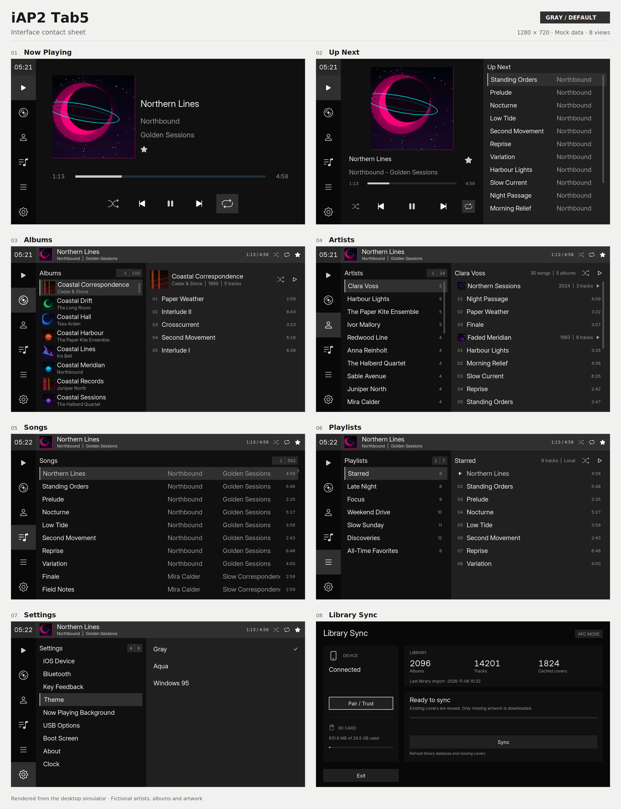
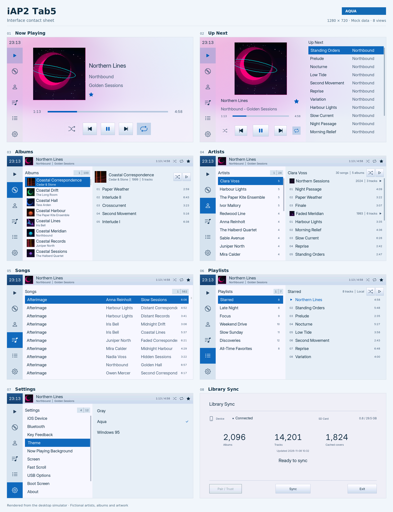

# iAP2 Tab5

An iPod / iPhone media controller for the **M5Stack Tab5**, with a shared
**LVGL 9.6** interface for the ESP32-P4 board and an SDL2 desktop simulator.
The UI runs at 1280×720 and supports a rotary controller, USB keyboard, Ulanzi
D100H remote, and optional touch input.

On hardware, **iAP2** provides playback control, Now Playing metadata, and
artwork. **AFC** copies the device's media database and album artwork to an SD
card; a host-side Python tool converts the database into the library used by
the UI. The simulator uses a bundled mock library and needs no Apple device or
MFi identity.

## UI overview

These contact sheets use the simulator's mock library and device data. Each
shows Now Playing, Up Next, Albums, Artists, Songs, Playlists, Settings, and
Library Sync. Click a sheet to view the screens at full resolution.

**Gray (default)**

[](docs/previews/ui-gray.png)

**Aqua**

[](docs/previews/ui-aqua.png)

## What it does

- Browse **Now Playing, Albums, Artists, Songs, Playlists, and Settings** with
  consistent knob/key navigation, virtualized lists, and a mini player.
- Control playback, shuffle, repeat, and seeking; start playback from library
  lists and save local stars per library.
- Show Now Playing artwork, album thumbnails, and an Up Next panel. When the
  device supplies a queue, its entries are matched against the imported library;
  otherwise the UI falls back to the list started on the Tab5 or the current track.
- Configure the device, upload libraries and firmware, inspect logs, inject
  keys, and capture screenshots through a Wi-Fi web interface.
- Preview the same UI on a desktop, including mock covers, keyboard/touch input,
  the optional KCN4M1 boot animation, and headless PNG screenshots.

## Run the desktop simulator

Run these commands from the repository root. On Debian / Ubuntu, install the
build tools and SDL2 development headers:

```bash
sudo apt install build-essential cmake ninja-build libsdl2-dev
cmake -S . -B build -G Ninja
cmake --build build -j
./build/tab5_sim
```

The first configure downloads the pinned **LVGL v9.6.0** release into
`build/_deps`. To use an existing checkout, configure with
`-DLVGL_SOURCE_DIR=/path/to/lvgl`. The `run` build target also starts the simulator:

```bash
cmake --build build --target run
```

The bundled library contains 24 artists, 100 albums, 562 tracks, and 6 playlists.
The mouse acts as the touchscreen. The simulator starts directly in the UI
unless a boot animation is requested.

### Screenshots and command-line options

```bash
# Open Albums with the menubar on the right.
./build/tab5_sim --screen 2 --menubar right

# Capture the UI without a display server.
mkdir -p build/screenshots
./build/tab5_sim --headless --screen 2 --keys enter \
    --screenshot build/screenshots/album.png --wait 1500

# Capture a fixed point in the boot animation.
./build/tab5_sim --headless --boot-freeze 3900 \
    --screenshot build/screenshots/boot.png --wait 300
```

| Option | Purpose |
| --- | --- |
| `--screen <1-6>` | Start on Now Playing, Albums, Artists, Songs, Playlists, or Settings |
| `--menubar <left\|right>` | Choose the menubar side |
| `--zoom <factor>` | Scale the window; default `1.0` |
| `--keys <list>` | Inject comma-separated keys, such as `2,enter` or `context` |
| `--afc <state>` | Preview AFC: `disconnected`, `ready`, `trust`, `syncing`, `done`, `error` |
| `--theme <0..2>` | Gray, Aqua, or Windows 95 |
| `--screenshot <path>` | Save a PNG and exit |
| `--wait <ms>` | Delay before capture; default `1000` |
| `--headless` | Use SDL's offscreen video driver |
| `--boot` | Play the KCN4M1 boot animation |
| `--boot-freeze <ms>` | Show the boot animation at a fixed time offset |
| `--no-boot` | Skip the boot animation |
| `--help` | Print command-line help |

On Linux, screenshot mode automatically uses the offscreen driver when neither
`DISPLAY` nor `WAYLAND_DISPLAY` is set. Explicit screen, menubar, or key options
skip the normal boot animation; `--boot-freeze` can still select a boot frame.

To regenerate the README contact sheets after changing the UI:

```bash
python3 -m venv build/contact-sheet-env
build/contact-sheet-env/bin/pip install cairosvg
build/contact-sheet-env/bin/python tools/gen_ui_contact_sheets.py --sim build/tab5_sim
```

## Controls

The simulator and hardware share the same logical actions:

| Input | Action |
| --- | --- |
| `Up` / `Down` | Move focus, like turning the knob |
| `Enter` | Activate; hold for 650 ms to open the context menu |
| `1`–`5` | Open Now Playing / Albums / Artists / Songs / Playlists |
| `6` or `Backspace` | Go back |
| `7` | Play / pause |
| `Page Up` / `Page Down` | Page the active list; Page Up toggles Up Next on Now Playing |
| `[` / `]` | Previous / next screen; `[` toggles Up Next on Now Playing |
| `C` | Open the context menu in the simulator |

On hardware, input can come from a USB HID keyboard or knob, the D100H over USB
or BLE, the serial console, or the web debug page. The serial equivalents
include `w` / `s` for knob movement, `b` for Back, and `c` for the context menu;
see the [full serial key map](firmware/README.md#serial-debug-keys).

Albums, Artists, Songs and Playlists require both an identified iPod and a
ready SD card. Their tiles are disabled and tab navigation skips them while
either is unavailable. Disconnecting during browsing returns to Now Playing;
Settings remains accessible. Reconnect the iPod to resume browsing. After
removing and reinserting the SD card, reboot to reload the cached library.

The D100H supports tap-to-skip and hold-to-seek on its previous/next controls.
Its top-left Back key acts on release. The top-middle Play/Pause key acts on
short release; holding it for two seconds turns off the screen without toggling
playback. A press that
wakes the screen is consumed through release, without navigating or playing.
Its top-right key opens the context menu on a tap and toggles Star on a hold.
Hold the knob down and turn it to adjust iPod volume: clockwise raises it,
counter-clockwise lowers it. A plain knob click activates on release;
releasing after a held turn does not activate the selected item. This works
over USB and BLE. Rapid rotation filters isolated reverse glitches before
navigation; a deliberate single reverse notch is delivered within 120 ms.
Pair it from **Settings → Bluetooth**, under **Search Devices**.

**Settings → Fast Scroll** selects the activation speed: Off or 1–5 pages per
1200 ms (default: 2 Pages). A quick spin switches to one visible page per notch,
with a short two-tone cue and twin contrasting rails on the cursor. A 1.5 second
pause or a direction reversal restores normal single-row precision. Speed uses
physical notches rather than the amplified page jumps; touch scrolling stays
unchanged.


**Settings → Screen** groups **Brightness** presets (**Low**, **Mid**, **High**)
and an **Idle Timer** with **30 min**, **1 hour**, and **Off**
(the default). Both section labels are inset and non-selectable.
A brightness setting of zero falls back to Low to keep the screen visible.
The idle timer runs only while playback is paused or stopped; touch, keyboard,
or keypad input restarts it. Hold the clock area for two seconds to turn off
the screen immediately, including during playback. The first touch or key
wakes the screen without activating a control. USB, playback and Wi-Fi keep running.

**Cover gradient** is the default Now Playing background, configurable in
**Settings → Now Playing Background**. It uses colors from the
current iPod artwork, including artwork that arrives after the page opens.
It selects a dominant hue and two distinct accents, then builds soft ambient
color lights across the whole screen. Broader overlapping fields spread the
cover colors evenly, while preserving light and shade. Gray uses deep colors;
Aqua uses matching pastels. The menu bar, clock area and Up Next panel show
the gradient through a faint theme tint. The selected menu tile and
shuffle/repeat backgrounds also use translucent tints. Text and icons stay readable.

A background worker renders at 320×180 and expands once to 1280×720 with the
ESP32-P4 PPA. Eight-bit color channels survive scaling; the final conversion
adds fine, stationary blue-noise dithering and packs RGB565 in place. This
avoids the visible Bayer grid and premature color banding. Matching artwork
reuses the cached result; page changes cancel obsolete work. The simulator and
devices without an available PPA use a CPU scaling fallback. The two working
images use about 1.8 MB more PSRAM in total than the former RGB565-only path.

Now Playing displays the first received cover immediately and upgrades it when
a larger source arrives. If a track settles for two seconds with no cover or
only a small source, it refreshes the Now Playing subscription once. This
recovers stale artwork responses without restarting playback. It waits for
active artwork transfers and decoding, and rapid track changes restart the
settling timer. Its track cache records the original dimensions, so
a later thumbnail cannot replace a sharper saved cover, including after a
reboot. Older caches remain readable with unknown source dimensions until a
new image is received.

## Build and set up the Tab5

The Tab5 has two processors with separate firmware and programming connections:

| Processor | Firmware | Programming connection |
| --- | --- | --- |
| **ESP32-P4** | This project's display, USB, and media-controller application | Tab5 USB-C port → computer |
| **ESP32-C6** | ESP-Hosted Wi-Fi/BLE co-processor firmware | Internal `J1 / C6_ISP` header → USB-to-UART adapter → computer |

For a first installation, complete both the [P4 procedure](#flash-the-esp32-p4-application)
and the [C6 procedure](#flash-the-esp32-c6-wi-fible-firmware), then configure the
SD card and import a library. Flashing the P4 does not update the C6. The web
firmware updater also updates only the P4 application.

### Prerequisites

- M5Stack Tab5, a USB-C **data** cable, an SD card, and an iAP2-capable iPod or iPhone.
- **ESP-IDF 5.5.6**, the version used by the current firmware dependency lock.
- An MFi P-256 certificate chain and private key for iAP2 authentication.
- Apple trust for AFC access: use **Pair / Trust** in AFC mode. Existing
  lockdownd pair records can also be imported.
- For the C6: a USB-to-UART programming jig set to **3.3 V**, providing both
  C6 power and 3.3 V UART signals, access to the internal programming header,
  and the included **ESP-Hosted 2.13.1** images.

The MFi identity and lockdownd pair record serve separate purposes. Neither is
included in this repository. The identity is required to build the P4 application;
the AFC pair record is generated on the Tab5 after Apple trust approval (or
imported from an existing host). The included C6 images need neither.

The commands below use Bash on Linux. Replace `/dev/ttyACM0` and `/dev/ttyUSB0`
with the actual ports on your computer. On macOS they usually look like
`/dev/cu.usbmodem…` and `/dev/cu.usbserial…`; on Windows, use the ESP-IDF terminal
and the corresponding `COM` ports. Espressif's
[platform setup guide](https://docs.espressif.com/projects/esp-idf/en/v5.5.6/esp32p4/get-started/index.html)
covers installing the tools on other operating systems.

### Flash the ESP32-P4 application

#### 1. Install and activate ESP-IDF

If ESP-IDF 5.5.6 is already installed, activate it with its `export.sh` and skip
the installation commands. For a new Debian / Ubuntu installation:

```bash
sudo apt install git wget flex bison gperf python3 python3-pip python3-venv \
    cmake ninja-build ccache libffi-dev libssl-dev dfu-util libusb-1.0-0
mkdir -p "$HOME/esp"
git clone --branch v5.5.6 --recursive https://github.com/espressif/esp-idf.git \
    "$HOME/esp/esp-idf-v5.5.6"
cd "$HOME/esp/esp-idf-v5.5.6"
./install.sh esp32p4,esp32c6
. ./export.sh
idf.py --version
python -m esptool version
```

`idf.py --version` should report `v5.5.6`. In each new terminal, activate the
environment again:

```bash
. "$HOME/esp/esp-idf-v5.5.6/export.sh"
```

The installer provides the compilers, Python environment, `idf.py`, and
`esptool`. See the [ESP-IDF 5.5.6 installation instructions](https://docs.espressif.com/projects/esp-idf/en/v5.5.6/esp32p4/get-started/linux-macos-setup.html)
for the full host setup.

#### 2. Generate the MFi identity and build

Return to this repository and generate the identity **before configuring the
firmware**. Replace the three example paths below with your local paths:

```bash
cd /path/to/iap2tab5
python3 tools/gen_iap2_identity.py \
    --cert /path/to/certificate.p7b \
    --key /path/to/identity.pk8

cd firmware
idf.py set-target esp32p4  # first configure only
idf.py build
```

With no arguments, the identity generator reads `../iap2cert/certificate.p7b`
and `../iap2cert/identity.pk8`, relative to the repository root. It writes the
ignored `firmware/main/iap2_identity.c`, which CMake requires.

The first build downloads the managed components. A successful build produces
these files under `firmware/`:

```text
build/iap2tab5.bin                       # P4 application; also used for web OTA
build/bootloader/bootloader.bin          # P4 bootloader
build/partition_table/partition-table.bin
build/flash_args                        # generated offsets and images for flashing
```

Keep the project's `sdkconfig.defaults`: it includes support for the tested
pre-revision-3 ESP32-P4 hardware. `set-target` resets the project configuration,
so subsequent builds normally need only `idf.py build`. When changing from IDF
5.4 to 5.5, run `idf.py fullclean` before rebuilding, then do a full flash.

**Generated firmware contains the MFi private key. Keep the identity and built
images private.** Lockdownd pair records also contain private keys and are stored
in the internal SPIFFS partition.

#### 3. Connect the P4 and identify its port

1. Disconnect the iPod and other USB peripherals during the initial flash.
2. Connect the Tab5's **USB-C** port directly to the computer with a data cable.
3. List the serial ports in the activated ESP-IDF environment:

   ```bash
   python -m serial.tools.list_ports -v
   ```

   On Linux, the P4's native USB Serial/JTAG port is commonly `/dev/ttyACM0`.
   Comparing the list before and after connecting the cable helps identify it.
4. Close any serial monitor that has the port open.

If the port is missing or automatic download-mode entry fails, use the Tab5's
physical procedure: **with USB-C connected, hold the power button until the
green LED flashes, then release it**. List the ports again, as the port name
may change. This is the Tab5's single-button download procedure, documented by
[M5Stack](https://docs.m5stack.com/en/core/Tab5#download-mode).

If this firmware was previously set to `usb_mode: 2`, change the SD card's
`config.json` to `"usb_mode": 0` before restarting into the application so that
USB-C remains available for the console. ROM download mode provides the recovery
path when the running application has taken over USB-C.

#### 4. Flash the complete P4 image and monitor startup

From the repository's `firmware/` directory:

```bash
idf.py -p /dev/ttyACM0 flash monitor
```

Use **`flash` for the first installation**. It writes the bootloader, partition
table, application, and other images listed in the build's generated flash
arguments. Let `idf.py` select their offsets. Wait for successful write/verify
messages before disconnecting the cable.

The monitor starts after flashing. If the Tab5 remains in download mode, turn
it off with a double-click of the power button and turn it on with a single
click. Reconnect the monitor if the USB port re-enumerates:

```bash
idf.py -p /dev/ttyACM0 monitor
```

Exit with **`Ctrl+]`**. Confirm that the application reaches its UI without a
repeated reset. An empty library is expected before importing one. C6 version
warnings or Wi-Fi/BLE problems may remain until the C6 procedure below is done.

#### 5. Later updates and recovery

For code-only updates while booting the factory application slot:

```bash
# Run in firmware/ with the ESP-IDF environment active.
idf.py build
idf.py -p /dev/ttyACM0 app-flash monitor
```

After a web OTA update, the active application is in an OTA slot; `app-flash`
writes the factory slot and may leave the older OTA application selected. Use
web OTA again, or return to the complete `flash` procedure when restoring the
factory application. Use a complete flash after changing the partition table
or bootloader as well. See [ESP-IDF's OTA boot selection](https://docs.espressif.com/projects/esp-idf/en/v5.5.6/esp32p4/api-reference/system/ota.html#ota-data-partition).

For a web update, open the Tab5's web page, select **`firmware/build/iap2tab5.bin`**
in the firmware OTA section, upload it, and wait for the reboot. The bootloader,
partition table, and C6 `network_adapter.bin` are not P4 OTA application images.
The equivalent upload from the repository root, using the default AP address, is:

```bash
curl --fail --data-binary @firmware/build/iap2tab5.bin \
    http://192.168.4.1/api/ota
```

If an update cannot boot or reach Wi-Fi, enter P4 download mode with the power
button and repeat `idf.py flash`. A complete flash is different from
`erase-flash`: a full-chip erase also deletes NVS settings, BLE bonds, and the
SPIFFS pair record. It is not required for normal updates.

### Flash the ESP32-C6 Wi-Fi/BLE firmware

This project's P4 host uses **ESP-Hosted 2.13.1**. A Tab5 still running the factory
1.4.1 C6 firmware needs a wired update to the matching images in
[`tools/c6_firmware/`](tools/c6_firmware/). You can skip this procedure if the
P4 log already reports C6 firmware `2.13.1` and the radio works.

The factory 1.4.1 firmware cannot perform the required upgrade through the P4's
SDIO link. The procedure below uses the C6's UART programming header. Later
ESP-Hosted versions provide co-processor OTA APIs, but this project's web OTA
page does not implement a C6 updater.

#### 1. Locate and wire the C6 programming header

Turn off the Tab5, disconnect USB power and the battery module if fitted, and
disconnect any other Tab5 power source. **Keep all Tab5 power disconnected
throughout the C6 flash.** Remove the rear cover to reach **`J1 / C6_ISP`**.
Use the PCB markings to identify pin 1; do not infer numbering from the
direction in which you hold the tablet.
[M5Stack's C6 programming guide](https://docs.m5stack.com/en/guide/tab5/c6_wifi_restore)
shows the connector location; the [Tab5 schematic, page 1](https://m5stack-doc.oss-cn-shenzhen.aliyuncs.com/1132/Tab5_Schematics_PDF.pdf)
shows its signals.

With the TTL programming jig unplugged from the computer, **set its voltage
selector to 3.3 V**. The jig supplies the C6 through J1 pin 1 and must also use
3.3 V UART signals. Wire TX and RX crossed:

| J1 pin | Tab5 signal | USB-to-UART adapter connection |
| --- | --- | --- |
| 1 | `WLAN_3.3V` | Jig **3.3 V output**; supplies C6 power |
| 2 | `RF_C6_TXD` | Adapter **RX** |
| 3 | `RF_C6_RXD` | Adapter **TX** |
| 4 | `RF_C6_RST` / EN | Adapter **RTS** for automatic reset, or manual reset |
| 5 | `RF_C6_IO9` / BOOT | Adapter **DTR** for automatic boot selection, or manual boot strap |
| 6 | GND | Adapter **GND** |

Leave **CTS** and any **5 V output** disconnected. Do not reconnect the Tab5's
USB-C cable, battery, or other power source while the jig is supplying 3.3 V.
Check that the jig's voltage selection applies to both its supply output and
UART signal levels.

If the adapter has no DTR/RTS, connect **3.3 V, TX, RX, and GND** and use the
manual procedure below for pins 4 and 5. The C6 boot strap is **IO9**.

#### 2. Power the C6 from the jig and check the images

1. Confirm that all Tab5 power sources are disconnected, the jig is set to
   **3.3 V**, and its 3.3 V output and GND are connected to J1 pins 1 and 6.
2. Connect the jig to the computer to supply the C6, then run
   `python -m serial.tools.list_ports -v` again. The **adapter's port**, commonly
   `/dev/ttyUSB0`, is the C6 programming port. The P4's USB-C cable stays
   disconnected; there is no P4 download-mode step in this procedure.
3. In an activated ESP-IDF terminal, return to the repository root and verify
   the checked-in images:

   ```bash
   cd /path/to/iap2tab5
   sha256sum -c tools/c6_firmware/SHA256SUMS
   ```

   All four files should report `OK`. The checked-in checksum file uses paths
   relative to the repository root. On macOS, use
   `shasum -a 256 -c tools/c6_firmware/SHA256SUMS` instead.

The initial C6 installation writes all four images:

| Flash offset | File in `tools/c6_firmware/` |
| --- | --- |
| `0x0000` | `bootloader.bin` |
| `0x8000` | `partition-table.bin` |
| `0xd000` | `ota_data_initial.bin` |
| `0x10000` | `network_adapter.bin` |

These images are for the **ESP32-C6 with 4 MB flash**. The P4 application and
its partition layout belong on the other processor.

#### 3. Write the C6 firmware

**With DTR/RTS automatic reset**, use the helper from the repository root:

```bash
bash tools/c6_firmware/flash_c6.sh /dev/ttyUSB0
```

The helper selects `esp32c6`, uses 460800 baud, and writes all four images with
DIO / 4 MB / 80 MHz flash settings. It tries to enter download mode through
DTR/RTS, then resets the C6 when finished.

**With manual boot/reset, or if automatic reset fails:**

1. Leave adapter DTR/RTS disconnected so they cannot override the manual straps.
   Keep the C6 powered by the jig's 3.3 V output, with all Tab5 power disconnected.
2. Connect **J1 pin 5 (IO9)** to **J1 pin 6 (GND)**.
3. Momentarily connect **J1 pin 4 (EN)** to GND, then release EN while keeping
   IO9 grounded. This resets the C6 into its ROM downloader.
4. Release IO9 after the reset. With no further reset, the C6 stays in download
   mode. This follows Espressif's [C6 boot-mode procedure](https://docs.espressif.com/projects/esptool/en/latest/esp32c6/advanced-topics/boot-mode-selection.html).
5. Run this complete command from the repository root:

   ```bash
   python -m esptool --chip esp32c6 -p /dev/ttyUSB0 -b 115200 \
       --before no_reset --after no_reset \
       write_flash --flash_mode dio --flash_size 4MB --flash_freq 40m \
       0x0     tools/c6_firmware/bootloader.bin \
       0x8000  tools/c6_firmware/partition-table.bin \
       0xd000  tools/c6_firmware/ota_data_initial.bin \
       0x10000 tools/c6_firmware/network_adapter.bin
   ```

This uses a slower UART rate and 40 MHz flash setting for the manual recovery
path. `--before no_reset` preserves the boot mode you just selected;
`--after no_reset` leaves restarting to you. The underscore spellings match the
helper and remain accepted as legacy aliases by esptool 5.x.

Wait for all writes and verification messages to finish. At 115200 baud, allow
several minutes. If a transfer fails, repeat the manual boot sequence before
retrying the command. The helper accepts only a port argument; use the direct
command above to change reset behavior, baud rate, or flash settings.

#### 4. Disconnect the jig, restore Tab5 power, and verify the radio

1. Unplug the jig from the computer to remove its 3.3 V supply. Remove any
   IO9-to-GND or EN-to-GND jumper and disconnect all jig wiring from J1,
   including the 3.3 V connection.
2. Restore the rear cover, reconnect the battery if used, and connect the Tab5's
   USB-C cable to the computer. Turn the Tab5 on normally, without holding the
   power button to enter download mode.
3. Monitor the P4 USB-C console from `firmware/`:

   ```bash
   idf.py -p /dev/ttyACM0 monitor
   ```

4. Look for **`C6 firmware 2.13.1`** in the current application's log, successful
   SDIO initialization, and no host/co-processor `Version mismatch` warning.
   `BT controller init RPC failed` should no longer appear.
5. With no station credentials configured, connect to **Tab5-Debug** and open
   **http://192.168.4.1**. Open **Settings → Bluetooth** and confirm that scanning
   finds the D100H when the remote is in pairing mode.

The [C6 firmware guide](tools/c6_firmware/README.md) also describes rebuilding
the slave images and restoring the factory firmware. Restoring factory 1.4.1
reintroduces the version mismatch with this project's 2.13.1 host.

### Flashing troubleshooting

| Symptom | What to check |
| --- | --- |
| `idf.py` or `esptool` is missing | Source the ESP-IDF 5.5.6 `export.sh` in this terminal. |
| P4 build cannot find `iap2_identity.c` | Generate the MFi identity before configuring or building. |
| No P4 serial port | Use a data cable, connect directly to USB-C, and enter download mode with the power button. Re-list ports after each reset. |
| Serial port is busy | Close other monitors, terminal programs, and flashing tools using that port. |
| `Permission denied` on Linux | Grant your user access to the serial device. On Debian / Ubuntu, add it to `dialout` with `sudo usermod -aG dialout "$USER"`, then log out and back in. |
| P4 image rejected because of chip revision | Use this project's pre-revision-3 defaults for the tested v1.3 board and rebuild with IDF 5.5.6. Do not bypass the revision check with a forced flash. |
| C6 connection times out | Select the adapter's port, confirm the jig is set to 3.3 V and powers J1 pin 1, check crossed TX/RX and common ground, and try the manual IO9/EN sequence. Keep all Tab5 power disconnected. |
| C6 write stops partway through | Check the jig's 3.3 V supply and stable UART wiring; keep Tab5 USB/battery power disconnected and retry the manual command at 115200 baud. |
| C6 flash succeeds but the radio stays offline | Remove boot/reset straps and all jig wiring, restore normal Tab5 power, and check the P4 log for the C6 version. |
| Old application still runs after `app-flash` | An OTA slot may still be selected; use web OTA or the complete P4 flash procedure. |

### SD card and Wi-Fi

The firmware mounts the card at `/sdcard`; FAT32 is recommended. Start with the
[SD configuration examples](docs/sd/). For station mode, create `wifi.txt` with
the SSID on the first line and password on the second:

```text
MyHomeWiFi
my-password
```

Valid SD credentials take priority and update a backup in NVS. If the card
cannot mount, or `wifi.txt` is missing or unusable, station mode uses that backup
so the web debugger remains reachable. Unchanged credentials cause no NVS writes.

With no usable SD or NVS credentials, the default configuration starts an open
**Tab5-Debug** access point at **http://192.168.4.1**. Failed station connections
are retried. AP mode can also be selected explicitly in `config.json`.

Open the Tab5's address in a browser to configure settings, upload a library or
pair record, sync the library, sync the clock, or install a firmware `.bin`
over the air. The dashboard shows Tab5 charging current separately from the
iPod battery, and offers Screen Off settings and iPod volume buttons.
The `/debug` page adds resumable live logs with filtering, display capture,
named navigation/media controls, keypad gesture tests, and power/link diagnostics.
Its display recorder samples backlight PWM and display timing at 10 Hz. Use
**Mark flicker + save** after a visible pulse to download the preceding trace.
Enable **Debug log to SD** to retain logs in `/sdcard/debug.log` across resets.
The web server has no authentication, so use it on a trusted network.

Typical card contents after setup and sync:

```text
/sdcard/
  config.json                   # UI, network, power, and USB settings
  wifi.txt                      # optional station credentials
  JPFONT.TTF                    # optional Japanese metadata font
  AFC/MLDB.SQL                   # copied media database
  AFC/MLDB.WAL                   # database write-ahead log, when present
  AFC/MLDB.SHM                   # database shared-memory file, when present
  lib/<short8>/library.bin       # converted media library
  lib/<short8>/thumbs.bin        # packed album thumbnails
  lib/<short8>/thumbs.idx        # thumbnail validity bitmap
  lib/<short8>/stars.csv         # local stars
  lib/<short8>/np.raw            # cached Now Playing artwork
  lib/<short8>/np.txt            # metadata identifying the cached artwork
```

`<short8>` is derived from the device's library identifier. The firmware manages
these directories and supports the older flat `/sdcard/library.bin` layout.
The hardware image uses the imported library; mock assets are simulator-only.

### USB ports and modes

Two independent settings control USB: **which ports act as hosts** and **which
Apple device protocol runs**. Both take effect at boot.

| Host setting | USB-A | USB-C |
| --- | --- | --- |
| `usb_mode: 0` — default | High-speed host for the Apple device or HID controller | Serial console and flashing |
| `usb_mode: 2` — Both A+C | High-speed host | Full-speed host through a powered hub/dock |

Choose the host setting in **Settings → USB Options** and reboot to apply it.
Dual-host mode needs a hub/dock that supplies 5 V upstream to the Tab5 and uses
Wi-Fi for debugging because the USB-C console is unavailable. Use mode `0` when
connecting USB-C to a PC for the serial console. The old mode `1` falls back to
mode `0`.

For simultaneous iPod and wired D100H use, the documented setup puts the iPod
on USB-A and the D100H behind a powered USB-C hub. The current USB host stack
cannot handle full-/low-speed devices behind a high-speed hub on USB-A; see
[USB modes and hub limitations](docs/usb-modes.md).

| Apple device mode | Purpose |
| --- | --- |
| **iAP2**, USB configuration 2 | Normal media UI, playback control, metadata, and Now Playing artwork |
| **AFC Sync**, USB configuration 4 | Database copying and album thumbnail sync |

These protocol modes are mutually exclusive. Switching between them saves the
selection in NVS and reboots. Quick/full sync jobs keep their result on screen;
choose **Exit** to restart in iAP2 mode.

## Import a media library

Library conversion runs on a host computer. Copying the database or running an
artwork sync on the Tab5 does not rebuild `library.bin`.

1. Enter **AFC Sync** mode and choose **Pair / Trust**. Unlock the Apple
   device and approve Trust on its screen. Existing pair records can also be
   uploaded. See [AFC pairing and bring-up](docs/afc-bringup.md).
2. Use **Copy iPod database** in the web UI to copy the database to
   `/sdcard/AFC/`. Copy `MLDB.SQL` and, if present, `MLDB.WAL` from the card to a
   host directory such as `/tmp/ipod-db/`.
3. From the repository root, convert the snapshot with Python 3:

   ```bash
   python3 tools/media_db_to_library.py \
       --db /tmp/ipod-db/MLDB.SQL \
       --wal /tmp/ipod-db/MLDB.WAL \
       --bin /tmp/ipod-db/library.bin \
       --out /tmp/ipod-db/library.json
   ```

   Omit `--wal` if no WAL was copied. The JSON output is optional.
4. Upload `library.bin` using the web UI, or send it directly to the Tab5's
   address (the example uses its default AP):

   ```bash
   curl --data-binary @/tmp/ipod-db/library.bin \
       http://192.168.4.1/api/library
   ```

   The upload replaces the active library file and reboots the device.
5. Run **Quick sync** for the first 64 albums or **Full sync** for the library's
   artwork, then return to iAP2 playback. Album thumbnails are cached on SD;
   large Now Playing artwork arrives separately over iAP2.

Repeat the conversion and upload after changing the device's library. See the
[media library import guide](docs/media-library-import.md) for serial transfers,
the binary format, fonts, and artwork cache details.

## Development

The shared UI calls the backend contract in
[`app/backend/player.h`](app/backend/player.h). The simulator supplies mock data;
ESP builds route the same API to the imported library and iAP2 host.

| Path | Contents |
| --- | --- |
| [`app/ui/`](app/ui/) | Screens, focus navigation, boot animation, and generated fonts |
| [`app/backend/`](app/backend/) | Player API, mock data/loading, hardware dispatch, and BLE remote state |
| [`sim/`](sim/) | SDL2 entry point, keyboard input, command-line options, and PNG capture |
| [`firmware/main/`](firmware/main/) | ESP-IDF app, iAP2, AFC/usbmux/lockdownd, USB input, SD storage, and web server |
| [`firmware/components/`](firmware/components/) | Local LVGL port and USB HID component fixes |
| [`assets/`](assets/) | Mock library/covers, source fonts, web page, and UI artwork |
| [`tools/`](tools/) | Library conversion, asset generators, identity generation, and C6 firmware |
| [`tests/`](tests/) | Host-side D100H protocol and gesture tests |

### Checks

The D100H tests compile the production codec with the host C compiler and run
without ESP-IDF:

```bash
python3 -m unittest discover -s tests -v
```

They cover BLE/HID framing, captured protocol vectors, heartbeat encoding,
top-right tap/hold handling, library transport, trust approval/retry, and pair
record persistence. Certificate validation additionally uses `libmbedtls-dev`
and Python `cryptography`; those checks are skipped when unavailable. Simulator screenshots are useful for reviewing UI
changes; hardware timing, USB behavior, and BLE still need a Tab5.

The optional LVGL integration tests feed pointer input through the production
Albums UI. They check dragging over artwork, titles, artists, and row padding
in both directions, plus tapping to open an album, across all three themes.
They also check the screen timer, two-second clock hold and wake-only input:

```bash
cmake -S . -B build -DIAP2TAB5_BUILD_UI_TESTS=ON
cmake --build build -j
ctest --test-dir build --output-on-failure
```

Optional browser tests in `tests/test_web_ui.py` use Playwright and Chromium.
They serve the web assets locally and mock every device API, covering battery
readings, unsaved settings, named controls, mobile layout and log resumption.
They are skipped when Playwright is unavailable.

### Regenerate assets

Generated assets are checked in, so these tools are only needed when changing
their sources. Run them from the repository root:

| Command | Purpose | Additional dependency |
| --- | --- | --- |
| `python3 tools/gen_mock_library.py` | Rebuild the deterministic mock library, covers, and thumbnails | Pillow |
| `python3 tools/gen_web_ui.py` | Embed `assets/web/index.html` in `firmware/main/web_index.h` | Python 3 |
| `python3 tools/gen_plug_art.py` | Embed the no-device illustration | Pillow |
| `./tools/gen_icons.sh` | Generate Bootstrap Icons font subsets | Node/npm (`lv_font_conv`) |
| `./tools/gen_inter_fonts.sh` | Generate proportional and tabular Inter fonts | Node/npm and Python `fonttools` |
| `./tools/gen_boot_font.sh` | Generate the VT323 boot font | Node/npm |

## Current limitations

- The browsable library uses AFC import. Optional iAP2 library notifications
  populate fallback album discovery order (`-DIAP2TAB5_FULL_LIBRARY_SYNC=ON`).
  Full notification sync has passed hardware testing; importing a complete
  catalog from those notifications is not implemented yet.
- Up Next depends on the queue supplied by the device and matching tracks in the
  imported library. Its fallback may show only the current track.
- Stars are stored locally in `stars.csv` and are not written back to the iPod.
- Unsupported artwork can fall back to a placeholder; the software JPEG decoder
  supports baseline JPEG only.
- Hardware display output is not yet tear-free. The simulator also uses a
  different rendering path and does not predict Tab5 performance.

## Further documentation

| Guide | Topics |
| --- | --- |
| [Firmware](firmware/README.md) | Configuration schema, partitions, serial commands, and hardware notes |
| [UI design](docs/design.md) | Layout, navigation, focus model, and playback behavior |
| [iAP2 bring-up](docs/iap2-bringup.md) | Link layer, authentication, identification, control, and artwork |
| [AFC bring-up](docs/afc-bringup.md) | usbmux, lockdownd, TLS, pairing, and file access |
| [Media library import](docs/media-library-import.md) | Database conversion, binary format, fonts, and artwork |
| [Star persistence](docs/stars-persistence.md) | Per-library star storage and matching |
| [USB modes](docs/usb-modes.md) | Port roles, powered hubs, charging, and boot configuration |
| [D100H driver notes](docs/d100h-ble-handover.md) | BLE protocol analysis and bring-up history |
| [C6 firmware](tools/c6_firmware/README.md) | ESP-Hosted images and flashing instructions |

Some bring-up documents retain historical experiments and older configurations;
use the current source and build files when working on the drivers.

## Third-party code and licenses

The project uses LVGL, SDL2, ESP-IDF/esp-bsp/ESP-Hosted, cJSON, stb, Bootstrap
Icons, Inter, VT323, and optional M PLUS 1p fonts. Each retains its own license;
font licenses are included in [`assets/fonts/`](assets/fonts/) and
[`tools/fonts/`](tools/fonts/), and cJSON's license is in
[`third_party/cjson/LICENSE`](third_party/cjson/LICENSE). There is currently no
project-wide license file.
